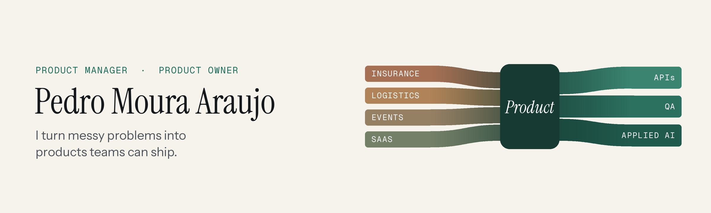
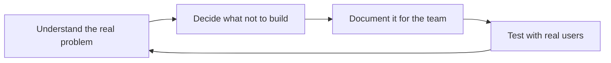

<picture>
  <source media="(prefers-color-scheme: dark)" srcset="assets/banner-dark.png">
  
</picture>

Product Manager and Product Owner with 5 years bridging business and technology, focused on APIs and integrations. In 2026 I led product on generative AI initiatives, from discovery and PRD to tested code.

> [!TIP]
> Open to product roles (Product Owner, Product Manager, Product Analyst), remote or on-site in Rio de Janeiro. Reach me on [LinkedIn](https://www.linkedin.com/in/pedroigormoura/).

## Products I've built

| Product | What it is | My product work | Outcome |
|---|---|---|---|
| **Radar de Vagas** [Repository](https://github.com/pedrin-ma/radar-de-vagas) · [Case on LinkedIn](https://www.linkedin.com/in/pedroigormoura/details/projects/) | Finds jobs across several Brazilian job sites, merges duplicates and scores each one from 0 to 100 with the math shown | I decided it never applies on the user's behalf and runs entirely on their computer. [Decisions](https://github.com/pedrin-ma/radar-de-vagas/blob/main/docs/decisoes.md) · [QA](https://github.com/pedrin-ma/radar-de-vagas/blob/main/docs/qualidade.md) | Test version in use by colleagues looking for jobs |
| **Conecta Iguaçu** [Case on LinkedIn](https://www.linkedin.com/in/pedroigormoura/details/projects/) | Civic platform for the city of Nova Iguaçu | Wrote the PRD and the admin panel spec and led AI-assisted development; end-to-end tests found 3 real bugs on the first run | 43 deliveries in 5 weeks (Aug–Sep 2026) |
| **VexDojo** [Case on LinkedIn](https://www.linkedin.com/in/pedroigormoura/details/projects/) | B2B SaaS for martial arts academies | Structured the backlog and discovery; led a security and LGPD (Brazil's data protection law) audit that became 27 issues in 6 priority waves | Pilot academy in production |
| **CatiVOU** [Case on LinkedIn](https://www.linkedin.com/in/pedroigormoura/details/projects/) | Marketplace for renting season-ticket stadium seats | Validated the model with a concierge test at two Copa Libertadores 2023 matches, delivering the cards myself; took the app from WebView to native | Native app on Google Play, featured by GE (Sep 2023) |

## How I work

Example: a client urgently asked for an "email inbox". The real need was tracking loads suspected of theft, so we delivered notifications to everyone involved in loading and unloading.

## Where I've worked

- **Insurance** · Icatu Seguros: impact analysis and documentation for the Life APIs (60+ APIs, 50 partners) and two AI agents in Microsoft Copilot.
- **Logistics** · Vector: Product Owner of the squad serving Bunge, COFCO and Gerdau.
- **Events** · SouFan Hub: Product Manager for ticketing and point-of-sale products.

## Tools

**Product:** Jira · Confluence · Azure DevOps · Miro  
**APIs and data:** REST APIs · Postman · Power BI · SharePoint  
**AI:** Microsoft Copilot · Claude Code

<b>Em português</b>

 

Product Manager e Product Owner com 5 anos na ponte entre negócio e tecnologia, com foco em APIs e integrações. Em 2026 liderei produto em iniciativas com IA generativa, da discovery e do PRD ao código testado.

**Aberto a posições de Produto** (Product Owner, Product Manager, Analista de Produto), remoto ou presencial no Rio de Janeiro. Fale comigo no [LinkedIn](https://www.linkedin.com/in/pedroigormoura/).

**Produtos que construí** (cases completos na [seção Projetos do LinkedIn](https://www.linkedin.com/in/pedroigormoura/details/projects/))

- **[Radar de Vagas](https://github.com/pedrin-ma/radar-de-vagas):** busca vagas em vários sites, junta as repetidas e dá uma nota de 0 a 100 com a conta explicada. Roda no computador da pessoa e nunca se candidata por ela. Versão de testes com colegas em recolocação.
- **Conecta Iguaçu:** plataforma cívica de Nova Iguaçu. Escrevi o PRD e a spec do painel administrativo e conduzi o desenvolvimento com IA: 43 entregas em 5 semanas.
- **VexDojo:** SaaS B2B para academias de artes marciais, com academia-piloto em produção. Backlog, discovery e auditoria de segurança e LGPD (27 issues em 6 ondas).
- **CatiVOU:** marketplace de aluguel de cadeiras cativas. Validei o modelo com teste concierge em dois jogos da Libertadores 2023 e levei o app de WebView a nativo.

**Onde já atuei:** Icatu Seguros (APIs de Vida e agentes de IA) · Vector (PO de squad enterprise) · SouFan Hub (PM de ingressos e PDV).

